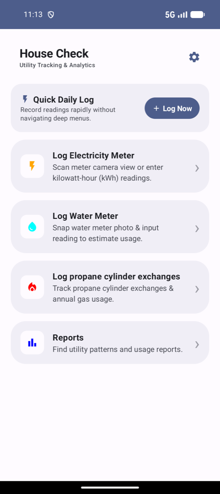
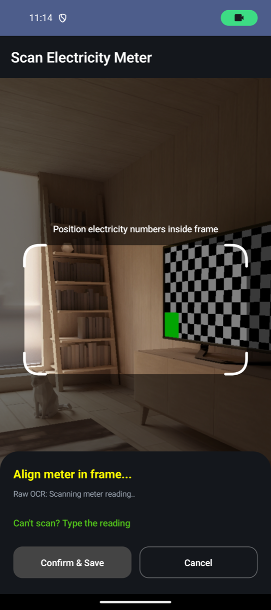
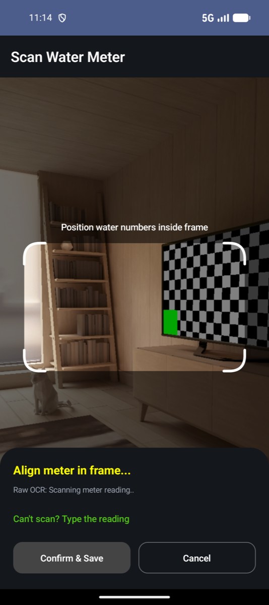
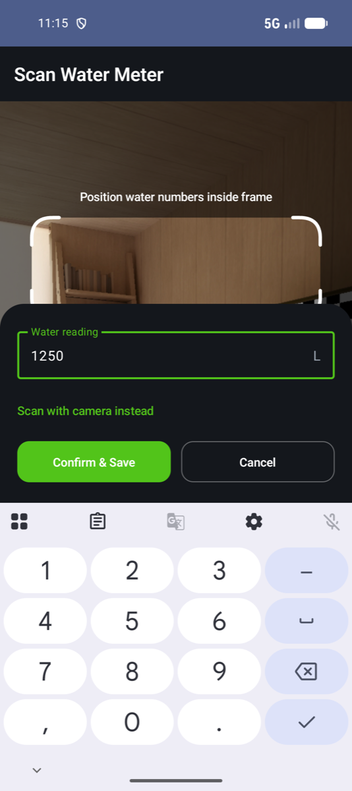
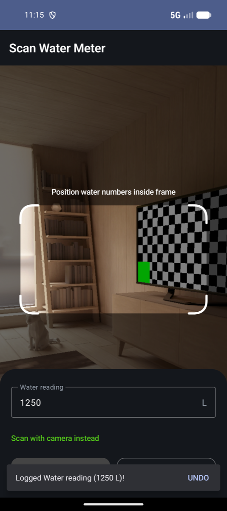
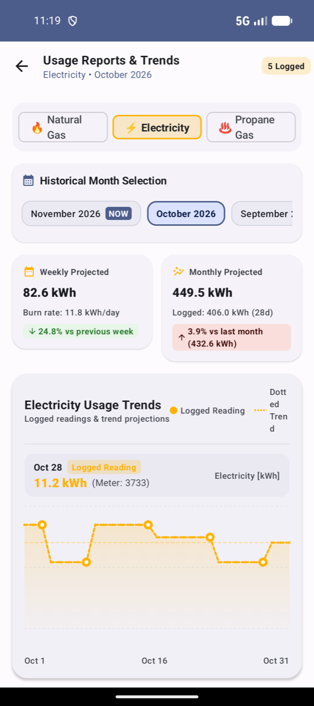
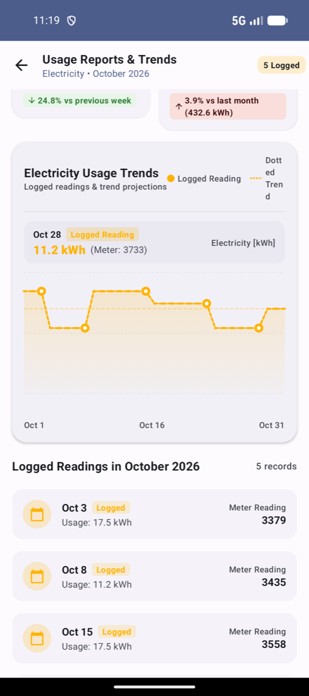
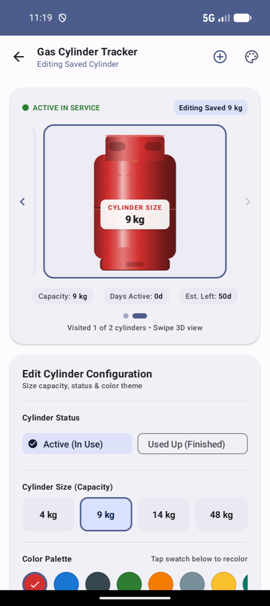
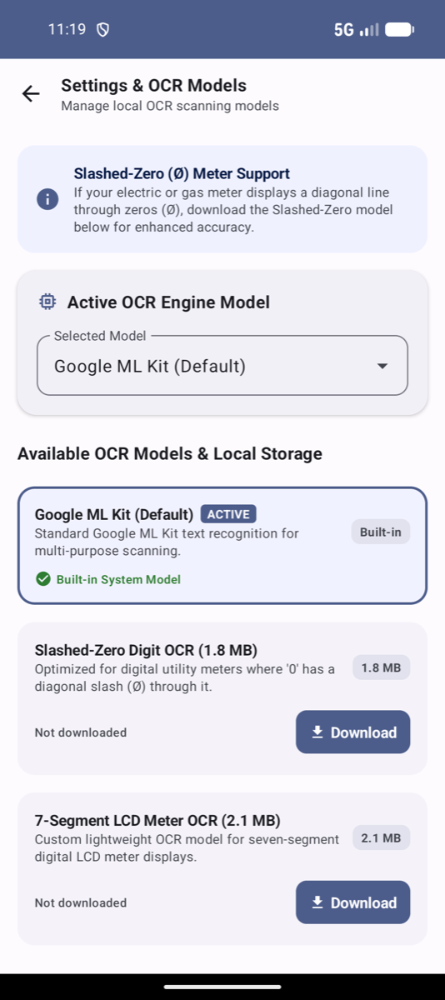

<div align="center">

# 🏠 House Check

**Utility tracking & analytics for Android: scan your meters, log readings in seconds, and see where your electricity, water and gas are going.**




</div>

---

## Contents

- [Why logging readings matters](#why-logging-readings-matters)
- [Features](#features)
- [How projections work](#how-projections-work)
- [Getting started](#getting-started)
- [Running the tests](#running-the-tests)
- [Tech stack](#tech-stack)
- [Project structure](#project-structure)

---

## Why logging readings matters

A utility bill tells you what you spent last month. A regular meter log tells you **what you are spending now**, while you can still change it.

| Benefit | What good logging gives you |
| --- | --- |
| 📉 **Catch waste early** | A jump in daily usage (a leaking toilet, a geyser element on the blink, a heater left on) shows up within days instead of on next month's bill. |
| 🔮 **Accurate projections** | Every reading sharpens the daily usage rate, so the month-end estimate gets closer to the real number as the month goes on. |
| 💡 **Budget with confidence** | Knowing your weekly and monthly units ahead of time makes prepaid top-ups and budgets predictable. |
| 🧾 **Verify your bills** | Your own dated meter history is evidence when an estimated or disputed bill doesn't match reality. |
| 🌦️ **Understand your patterns** | Usage per day, compared week-on-week and month-on-month, shows how seasons, weather and habits change your consumption. |
| 🔋 **Prepaid peace of mind** | For prepaid electricity, regular readings show how many days of units you have left before you run out. |

> **Rule of thumb:** the more often you log, the better the picture. Readings a few days apart give accurate daily usage. Readings weeks apart still work, but the usage is averaged over a longer stretch.

---

## Features

### 📷 Scan a meter with the camera

Point the camera at the meter and the reading is pulled from the display in real time with on-device ML Kit text recognition. The same scanner powers **electricity** (kWh) and **water** (m³ / L) meters, and the frame, hint text and units adapt to the utility.

<p align="center">
  
  &nbsp;&nbsp;
  
</p>

### ⌨️ Type the reading when scanning isn't possible

Glare, a dirty dial or a meter in a dark cupboard? Tap **"Can't scan? Type the reading"** to enter it by hand. The field starts with whatever the camera detected, only accepts valid numbers, and stays above the keyboard.

### ↩️ Instant feedback with Undo

Every saved reading shows a confirmation snackbar with **UNDO**. Tap it to remove the entry and stay on the screen to try again. Otherwise the scanner closes on its own.

<p align="center">
  
  &nbsp;&nbsp;
  
</p>

### 📊 Usage reports & projections

Pick a utility and a month to see:

- **Weekly projection:** units for the coming week, the daily usage rate, and the change against the previous week.
- **Monthly projection:** units measured so far, a month-end estimate, and the change against last month.
- **Interactive trend graph:** solid points for logged readings, a dotted line for usage between them. Drag across the graph to inspect any day.
- **Reading history:** every logged reading for the month, with its meter value.

<p align="center">
  
  &nbsp;&nbsp;
  
</p>

### 🔥 Gas cylinder tracker

Track LPG / propane cylinders: swipe through your cylinders, set size (4–48 kg), status and colour, and see days in service and estimated days left. Changes can be undone from the snackbar.

### ⚙️ OCR model settings

Choose the OCR engine used for scanning. Google ML Kit is built in, and optional models for **slashed-zero (Ø)** and **7-segment LCD** meters can be downloaded for better accuracy on those displays.

<p align="center">
  
  &nbsp;&nbsp;
  
</p>

---

## How projections work

House Check treats every log as a **meter reading**, not a purchase. Usage comes from the **difference between two consecutive readings**, spread evenly across the days between them:

```text
Day 1 reading: 140 kWh
Day 5 reading:  90 kWh
──────────────────────────────
Difference:     50 kWh over 4 days
Daily usage:    12.5 kWh/day for days 2, 3, 4 and 5
```

- Works for meters that **count down** (prepaid) and meters that **count up**.
- The first reading of a month is paired with the last reading of the previous month, so no days are lost at month boundaries.
- **Weekly projection** = average usage over the last 7 measured days × 7.
- **Monthly projection** = usage measured so far + (average daily usage × days not yet covered by a reading).
- Days after your latest reading are shown as an estimate until the next reading comes in.

---

## Getting started

### Requirements

| Tool | Version |
| --- | --- |
| Android Studio | Koala (2024.1) or newer |
| JDK | 17 |
| Android SDK | compileSdk 35, minSdk 28 (Android 9) |
| Device | Physical device or emulator with a camera (Android 10+ for the scanner) |

### 1. Clone the repository

```bash
git clone https://github.com/glucode-ratjatji/HouseKeeper---Android-Utility-App.git
```

```bash
cd HouseKeeper---Android-Utility-App
```

### 2. Run from Android Studio

1. Open the project folder in Android Studio (**File → Open**).
2. Let Gradle sync finish.
3. Pick a device or emulator and press **Run ▶**.
4. Grant the **camera permission** when the scanner asks for it.

### 3. Or build from the command line

Build a debug APK:

```bash
./gradlew :app:assembleDebug
```

Install it on a connected device or running emulator:

```bash
./gradlew :app:installDebug
```

The APK is written to `app/build/outputs/apk/debug/`.

### Sample data

On first launch with an empty database, the app seeds three months of sample readings for electricity, natural gas and propane, so the Reports screen has something to show. To start fresh, clear the app's storage in Android settings (or run `adb shell pm clear de.yanneckreiss.cameraxtutorial`).

### Testing the camera on an emulator

The emulator's virtual camera shows a 3D room, not a meter, so OCR won't find a reading. Use **"Can't scan? Type the reading"** to log values, or point a webcam-backed emulator camera at a real meter photo.

---

## Running the tests

Run all unit tests:

```bash
./gradlew :app:testDebugUnitTest
```

Unit tests cover the projection engine, meter reading parsing (kWh, m³ and litres), anomaly detection, weather correlation and the gas cylinder model. Reports are written to `app/build/reports/tests/testDebugUnitTest/index.html`.

---

## Tech stack

- **UI:** Jetpack Compose, Material 3, Navigation Compose
- **Camera & OCR:** CameraX, Google ML Kit Text Recognition
- **Architecture:** MVVM with `StateFlow`, Hilt dependency injection
- **Storage:** Room
- **Dates & concurrency:** kotlinx-datetime, Kotlin Coroutines & Flow
- **Testing:** JUnit 4, kotlinx-coroutines-test

---

## Project structure

```text
app/src/main/java/de/yanneckreiss/mlkittutorial/
├── AppNavHost.kt              # Navigation routes (home, scanners, gas, reports, settings)
├── MeterSelectionScreen.kt    # Home dashboard
├── ui/camera/                 # CameraX scanner, ML Kit analyzer, MeterReadingParser
├── entry/                     # Entry entity, Room DAO, repository, EntryViewModel
├── reports/                   # Reports screen, TrendsProjectionEngine, graph
├── gas/                       # Gas cylinder tracker
├── settings/                  # OCR model selection & downloads
└── worker/                    # Background usage anomaly checks
```

---

<div align="center">

Camera + ML Kit foundation adapted from Yanneck Reiß's [Jetpack Compose CameraX ML Kit showcase](https://youtu.be/wCADCaeS8-A).

</div>
